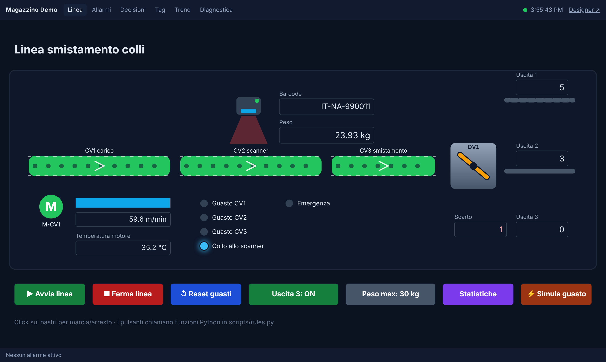
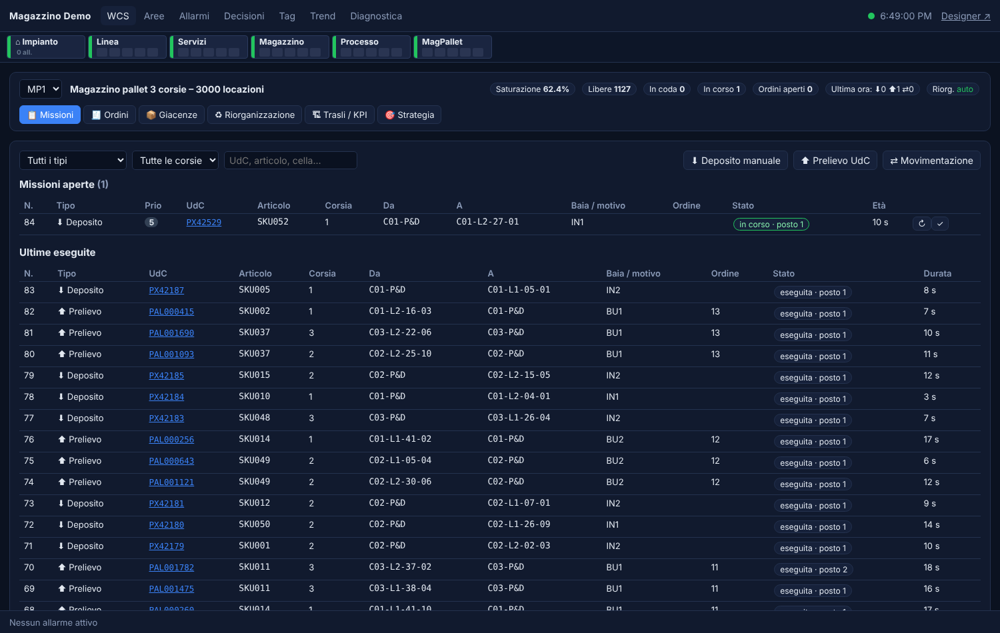
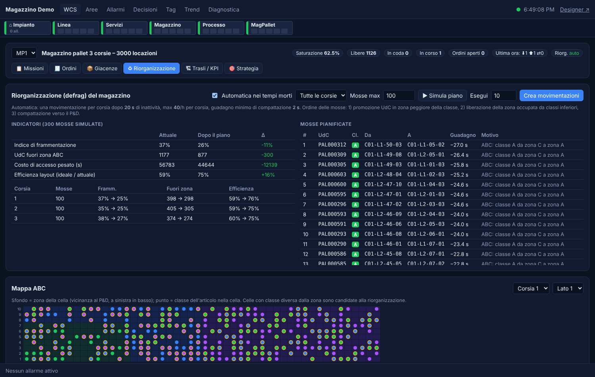

# PTWCS – WCS-SCADA

Warehouse Control System con funzioni SCADA. Il core è in **Rust**, le regole sono **grafiche (no-code)** o in **Python**, e l'HMI web ha un **Designer** in stile Ignition Perspective.

| | |
|---|---|
|  |  |
|  |  |

## Funzioni principali

- **PLC**: Siemens S7 (stack nativo, senza librerie C), Modbus TCP, OPC UA, EtherNet/IP (Logix) e un driver simulato.
- **Protocollo request/reply** definito nel Designer:
  - il telegramma è una UDT con ruoli (`request`, `response`, `input`, `output`);
  - handshake a **contatore** (ReqID/RespID) o a **flag** (Req/Ack).
- **Smistamento**:
  - regole grafiche ordinate, con test e traccia condizione per condizione;
  - **classi di smistamento** (pattern e barcode) locali o fornite dal **WMS**;
  - richiesta della destinazione al WMS via REST, con cache;
  - poi la funzione Python del punto e infine il fallback.
- **Tag**:
  - **UDT** con parametri e indirizzi a template (`DB{DB}.DBW{Base+2}`);
  - **scan class** per frequenza di lettura;
  - allarmi definiti sul tag;
  - modifiche dal Designer applicate **a caldo**, riavviando solo i driver coinvolti.
- **SCADA**:
  - viste multipagina e **aree** gerarchiche: allarmi, errori di qualità e perdita di comunicazione vanno nell'area del tag;
  - panoramica per area, trend, storico, log delle decisioni, audit.
- **Designer**, con quattro workspace:
  - **Viste**: componenti, libreria simboli a menu, import SVG, binding, eventi, parametri, viste incorporate, faceplate;
  - **Tag e UDT**: tag, tipi e istanze UDT, trend;
  - **Smistamento**: protocollo, regole, classi, WMS;
  - **Progetto**: aree, scan class, script a timer, driver.
- **Magazzino automatico** (AS/RS): locazioni persistenti, allocazione celle, missioni ai trasli, viste aggregate e di dettaglio (esempio con 3000 locazioni).
- **WCS per magazzini a trasloelevatori** (pagina runtime **WCS**):
  - anagrafica UdC (articolo, quantità, lotto, altezza, ingresso) letta dal telegramma di ingresso;
  - strategie di stoccaggio: zone e classi **ABC**, distribuzione degli articoli sulle corsie, sagome per livello;
  - missioni con **priorità**, sospensione, rimessa in coda, conferma manuale; **movimentazioni** cella→cella (tipo 3);
  - **ordini di prelievo FIFO** con avanzamento e mancanze;
  - **riorganizzazione (defrag)** automatica nei tempi morti, con simulazione del piano e indici di frammentazione;
  - **KPI dei trasli**: utilizzo, disponibilità, missioni/h, ciclo medio, cicli doppi.
- **Libreria standard** (`stdlib/`, parte dello SCADA e indipendente dal progetto): 74 simboli in 3 menu (Intralogistica, Macchine, Processo), 28 UDT standard per famiglia e **un faceplate per ogni simbolo**.
- **Login, ruoli e permessi** configurabili dal Designer:
  - 12 permessi per runtime, WCS, Designer e amministrazione;
  - ruoli per vista (accesso e comandi), per tag e UDT (scrittura) e per singola azione;
  - utenti con password Argon2, sessioni, blocco dopo tentativi errati, audit con l'utente.
- **Audit trail**:
  - chi, quando, cosa e da quale client, con valori prima/dopo;
  - riepilogo delle modifiche al progetto;
  - consultazione con filtri e aggiornamento in tempo reale, esportazione CSV.
- **Processo**: ricette (tipi con parametri → tag, unità multiple, limiti, versioni, confronto con il PLC) e sequenze a passi stile SFC (azioni, transizioni, timeout, pausa, conferma operatore, avvio da PLC, storico delle esecuzioni).
- **Tema chiaro e scuro** per runtime, Designer e manuale.
- **Menu tasto destro** al posto di quello del browser, ovunque:
  - Designer: modifica delle viste (copia, incolla, elimina, ordine, allineamento…), editor degli script, campi e tabelle (taglia/copia/incolla), aggiorna sezione, vai a workspace, salva, guida del riquadro;
  - runtime: navigazione tra viste e aree;
  - manuale.

## Avvio rapido (demo)

Servono Rust ≥ 1.85 e Python ≥ 3.9 (il runtime non richiede pacchetti Python).

```bash
cargo build --release
```

PLC Modbus simulato (linea di smistamento):

```bash
./target/release/plc_sim 127.0.0.1:5020
```

WMS di prova (facoltativo, per la demo delle classi WMS):

```bash
python3 tools/mock_wms.py 8090
```

WCS:

```bash
./target/release/wcs_scada config/plant.yaml
```

Runtime su http://localhost:8080/ e Designer su http://localhost:8080/designer.html. La demo comprende:
- la **Linea**: scanner con smistamento su 3 uscite più scarto, regole grafiche, WMS e classi;
- il **Magazzino**: baia, porte, nastri, lift, traslo, scaffali, AGV e serbatoio, animati da uno script a timer; ogni elemento apre il suo faceplate.

## Esempio: magazzino automatico pallet (MP1)

Struttura: **2 ingressi, 2 uscite, 3 trasloelevatori (uno a doppia UdC), 3000 locazioni** (3 corsie × 2 lati × 50 colonne × 10 livelli).

| | |
|---|---|
|  |  |

**Il WCS (modulo `warehouse.rs`)**:
- gestisce locazioni e UdC su SQLite (persistenti al riavvio);
- sceglie corsia e cella: meno missioni in coda, poi più celle libere, poi cella più vicina al P&D; esclude le corsie con traslo in guasto o non in automatico;
- gestisce le missioni di deposito e prelievo, con prelievi bilanciati tra le baie d'uscita;
- dialoga con i trasli tramite un telegramma missioni (UDT `TrasloMissioni`):
  1. il WCS scrive tipo, origine e destinazione (colonna 0 = P&D), poi `Start` = 1;
  2. il PLC alza `Busy` e il WCS abbassa `Start`;
  3. a fine missione il PLC scrive `Done` = id missione e abbassa `Busy`.

**Traslo a doppia UdC**: si attiva per corsia con `slots: 2` (nell'esempio è la corsia 3, UDT `TrasloDoppiaUdC`).
- Il telegramma ha un secondo posto con i campi a suffisso `2`: `Mission2`, `Type2`, `Src…2`, `Dst…2`, `DstOut2`, `Done2`; inoltre `Loaded2` e `Fork2`.
- Il dispatcher invia fino a **due missioni per ciclo**, scegliendo come compagna una missione dello stesso tipo con la cella più vicina. Con una sola missione in coda attende fino a `pair_wait_s` secondi prima di partire con il solo posto 1.
- Il PLC scrive `Done` e `Done2` quando completa ciascuna missione, e i due posti si chiudono in modo indipendente.
- In libreria ci sono i simboli `asrs_lane2` (pianta) e `asrs_crane_mast2` (fronte), con relativi faceplate.

**Ingressi IN1/IN2**: telegramma request/reply (UDT `TelegrammaIngresso`) con regole grafiche:
- NOREAD, sovrappeso e fuori sagoma → respinto, con il codice esito;
- altrimenti l'uscita **`store:MP1`** alloca cella e missione e risponde con la corsia.

Pallet doppi e magazzino pieno finiscono nel default ("non stoccabile").

**Grafica** (le 3000 celle non sono tutte disegnate):
- **Panoramica** `mag_pallet`: ogni lato di corsia è aggregato in blocchi di 5 colonne, colorati per saturazione media sui 10 livelli. Mostra i trasli in movimento lungo la corsia, ingressi e uscite, i KPI per corsia e totali e le missioni.
- **Prospetto corsia** `mag_pallet_corsia`, aperto cliccando una corsia (navigazione con parametro `aisle`): mostra le 500 celle di ogni lato con il traslo sovrapposto. Il click su una cella apre dettaglio, prelievo e blocco. **Cerca UdC** apre la corsia giusta ed evidenzia la cella.
- Componenti riutilizzabili: `whmap` (modalità *pianta*, *blocchi*, *celle*), `whsummary` (KPI), `whmissions`.
- Azione evento *Magazzino*: cerca, preleva o deposita.

**WCS nell'esempio**: 60 articoli demo con storico prelievi simulato, un ordine casuale ogni 30 s, strategia ABC attiva, riorganizzazione automatica dopo 20 s di inattività di una corsia, livelli 1–2 alti 1800 mm e gli altri 1500 mm. Gli ingressi leggono anche `Sku` e `Qty` dal telegramma. Vedi la sezione [WCS](#wcs-magazzini-automatici-a-trasloelevatori).

**API**: `/api/wh/{nome}/summary`, `side?aisle=&side=`, `missions`, `outbound`, `inbound`, `location`, `find?lu=`, `mission/{id}/{azione}` e le API WCS descritte sotto.

Per ricreare l'esempio, a WCS avviato:

```bash
python3 tools/build_demo_pallet.py
```

La simulazione dei PLC (arrivi pallet, rulliere, trasli, baie) è lo script a timer `scripts/sim_pallet.py`, con lo stato condiviso in `scripts/_magpallet.py`.

## WCS magazzini automatici a trasloelevatori

Runtime → **WCS** (`#/wcs/<magazzino>`), configurazione nel Designer → Progetto → **Magazzini**. Logica in `src/warehouse.rs`.

| | |
|---|---|
|  |  |

**Anagrafica UdC**: articolo, quantità, lotto, altezza, peso e data di ingresso (base del FIFO).
- Al deposito da protocollo, l'uscita `store:<magazzino>` riceve tutti i campi del telegramma. Sono riconosciuti `sku`/`articolo`, `qty`/`qta`, `lot`/`lotto`, `height`/`altezza` e `weight`/`peso`.
- Rettifiche inventariali dal runtime (dialogo UdC).

**Strategia di stoccaggio** (`strategy`):
- **Zone**: le celle di ogni corsia sono ordinate per tempo di traslazione dal P&D, con moto simultaneo X/Y (`col_time_s`, `lvl_time_s`). Le prime `a_zone_pct` celle sono zona A, le successive `b_zone_pct` zona B, il resto zona C.
- **Classi articolo**: dalla frequenza di prelievo nella finestra `abc_window_h`. Il primo `a_sku_pct` è classe A, il successivo `b_sku_pct` classe B, il resto (compresi gli articoli mai prelevati) classe C.
- **Cella**: classe A → zona A, poi B, poi C; classe B → B, C, A; classe C → C, B, A. Dentro la zona, la cella libera più vicina al P&D. Senza articolo, la cella più vicina.
- **Corsia**: punteggio minimo = missioni in coda + 0,5 × UdC dello stesso articolo nella corsia (`spread_sku`) − quota di celle libere. Escluse le corsie con traslo in guasto o non in automatico.
- **Sagoma**: `level_max_height_mm` per livello; una UdC più alta di ogni livello è rifiutata.

**Missioni**:
- Tipi: 1 deposito, 2 prelievo, 3 movimentazione cella→cella (stessa corsia; il telegramma usa gli stessi campi Src/Dst).
- **Priorità** da 1 a 9. Il dispatcher usa la priorità effettiva = priorità + 1 punto ogni 2 minuti di attesa, così nessuna missione resta ferma all'infinito.
- Azioni operatore:
  - **sospendi**/**rilascia**;
  - **cambia priorità**;
  - **annulla** (solo in coda);
  - **rimetti in coda** (missione persa dal PLC);
  - **conferma manuale** (le celle si aggiornano come a missione eseguita).
- Trasli a doppia UdC: la compagna è dello stesso tipo e con celle vicine. Le missioni urgenti (priorità ≥ 8) non attendono la compagna.

**Ordini di prelievo**:
- Righe articolo/quantità, coperte con UdC intere in ordine **FIFO** (data di ingresso) e poi per vicinanza al P&D.
- Stati: *in attesa giacenza*, *in prelievo*, *evaso*, *chiuso con mancanze*, *annullato*.
- Gli ordini in attesa vengono ricoperti automaticamente quando arrivano nuove UdC.
- Ogni prelievo eseguito alimenta lo storico che determina le classi ABC.

**Riorganizzazione / defrag** (`reorg`):
- Ordine delle mosse:
  1. **promozione**: le UdC in una zona peggiore della propria classe vanno nella zona giusta (prima la classe A, prima le più lontane);
  2. **liberazione**: se la zona giusta è piena, si sposta altrove una UdC di classe inferiore che la occupa;
  3. **compattazione**: le UdC più lontane vanno nella cella libera più vicina della stessa zona, se il guadagno è almeno `min_gain_s`.
- Esecuzione **automatica** solo nei tempi morti: una mossa per corsia dopo `idle_s` secondi senza missioni, al massimo `max_per_hour` all'ora, a priorità 1.
- Si può anche **simulare il piano** e creare subito N mosse (pagina WCS, scheda *Riorganizzazione*).
- Indicatori del piano:
  - **indice di frammentazione**: celle libere dentro la regione compatta ideale / celle occupate;
  - **UdC fuori zona**;
  - **costo di accesso pesato**: Σ peso classe (A 3, B 2, C 1) × tempo di traslazione;
  - **efficienza del layout**: costo ideale / costo attuale.
- Nella demo MP1 il piano su 300 mosse per corsia porta la frammentazione dal 38% al 26% e l'efficienza dal 59% al 75%.
- La **Mappa ABC** mostra per ogni lato di corsia la zona di ogni cella e la classe di ogni UdC, e segnala quelle fuori zona.

**KPI dei trasli** (ultima ora):
- utilizzo (tempo in ciclo), disponibilità (tempo senza guasto);
- missioni/h per tipo, ciclo medio, cicli doppi;
- grafico delle missioni eseguite a intervalli di 5 minuti.

| API WCS | |
|---|---|
| `GET /api/wh/{w}/kpi` | KPI per traslo e serie oraria |
| `GET /api/wh/{w}/stock` | giacenza per articolo, classi, zone |
| `GET /api/wh/{w}/lus?sku=&q=` | UdC in ordine FIFO |
| `GET/POST /api/wh/{w}/lu/{udc}` | anagrafica / rettifica |
| `GET/POST /api/wh/{w}/orders` | elenco / nuovo ordine `{reference, bay, priority, lines:[{sku, qty}]}` |
| `POST /api/wh/{w}/order/{id}/{cancel\|close\|priority}` | azioni ordine |
| `POST /api/wh/{w}/mission/{id}/{hold\|release\|priority\|cancel\|requeue\|done}` | azioni missione |
| `POST /api/wh/{w}/move` | movimentazione `{lu, dst?}` |
| `GET /api/wh/{w}/reorg?aisle=&max=` | piano di riorganizzazione simulato |
| `POST /api/wh/{w}/reorg` | `{enabled}` e/o `{run: N, aisle}` |

## Architettura

```
 Runtime HMI (index.html) ─┐            ┌─ Designer (designer.html)
                           │ REST + WebSocket
┌──────────────────────────┴────────────┴──────────────────────────────┐
│ web.rs       API, WebSocket live, viste, simboli, libreria, progetto  │
│ app.rs       stato, applicazione a caldo del progetto (driver,        │
│              punti di decisione, timer riavviati solo se cambiano)    │
│ config.rs    plant.yaml + project.yaml → config effettiva (UDT        │
│              espanse, telegrammi risolti, validazione completa)       │
│ decision.rs  handshake contatore/flag → regole → Python → fallback    │
│ rules.rs     motore regole grafiche (condizioni, rotazione, class:/wms:)│
│ sorting.rs   classi di smistamento, client WMS (cache, sync classi)   │
│ alarms.rs    allarmi per area, qualità, comunicazione (ISA-18.2)      │
│ script.rs    2 processi Python isolati: decisioni / HMI + timer       │
│ store.rs     SQLite: decisioni, allarmi, storico, audit               │
│ tagdb.rs     immagine live dei tag (qualità, timestamp)               │
│ drivers/     s7 · modbus · opcua · eip · sim  (scan class, blocchi)   │
└───────────────────────────────────┬──────────────────────────────────┘
                                    PLC                        WMS (REST)
```

Il **file di impianto** `config/plant.yaml` contiene server, scripting e driver, e si scrive a mano.

Il **progetto** `config/project.yaml` contiene aree, scan class, UDT, tag, punti di decisione, classi, WMS e timer, ed è gestito dal Designer. I salvataggi sono validati per intero: indirizzi, riferimenti, ruoli del telegramma. Prima di sovrascrivere il progetto viene fatto un backup.

Le regole grafiche stanno in `config/rules/<punto>.json` e le viste in `config/views/*.json`.

## Protocollo request/reply

Il telegramma si definisce come **tipo UDT** con un ruolo per membro. Per esempio, in un DB S7:

| Membro | Ruolo | Indirizzo (template) | Scritto da |
|---|---|---|---|
| ReqID | request | `DB{DB}.DBW{Base+0}` | PLC |
| Barcode | input | `DB{DB}.DBB{Base+2}` (STRING[20]) | PLC |
| Weight | input | `DB{DB}.DBD{Base+24}` | PLC |
| RespID | response | `DB{DB}.DBW{Base+28}` | WCS |
| Destination | output | `DB{DB}.DBW{Base+30}` | WCS |
| Result | output | `DB{DB}.DBW{Base+32}` | WCS |

Si crea un'istanza per ogni scanner (`SC1`, `SC2`… con il proprio DB/Base) e un punto di decisione con `telegram: SC1`. Gli alias delle regole sono i nomi dei membri in minuscolo (`barcode`, `weight`, `destination`…).

**Handshake a contatore**:
1. il PLC scrive i dati e poi incrementa ReqID;
2. il WCS decide, scrive le uscite e per ultimo RespID = ReqID;
3. il PLC usa le uscite solo quando RespID == ReqID; al timeout applica il proprio default.

**Handshake a flag**:
1. il PLC alza Req;
2. il WCS scrive le uscite e alza Ack;
3. il PLC abbassa Req;
4. il WCS abbassa Ack.

Tieni dati e request nella stessa area contigua, così vengono letti nello stesso blocco.

## Regole di smistamento

Sono un elenco ordinato: vince la **prima** regola abilitata le cui condizioni sono vere.

**Condizioni**:
- confronti `=`, `≠`, `>`, `≥`, `<`, `≤`;
- *compreso tra*, *inizia con*, *finisce con*, *contiene*, *è uno di*, *regex*, *vuoto*;
- *appartiene alla classe*, *ha una classe*, *il WMS conosce la destinazione*.

Si combinano con TUTTE oppure ALMENO UNA. I campi sono gli input del telegramma, `request_id` o `tag:Nome` (qualsiasi tag live).

**Uscite**:

| Valore | Effetto |
|---|---|
| `3` | valore fisso |
| `1\|2` | rotazione tra destinazioni equivalenti |
| `tag:Nome` | valore di un tag |
| `class:barcode` | destinazione della classe del collo |
| `wms:barcode` | destinazione chiesta al WMS |

Se un valore `class:` o `wms:` non si risolve, la regola viene saltata e si prova la successiva, così si costruiscono catene di fallback (es. WMS → classe → default). Una regola può anche delegare a una funzione Python.

**Ordine di decisione**: regole → **default** delle regole → **funzione Python** del punto → **fallback** del punto. Ogni decisione registra la regola che l'ha presa. Nel Designer si vedono i contatori per regola e si possono **provare** le bozze con dati di esempio prima di salvarle.

**WMS**. Endpoint configurabili:
- `GET {base}/parcels/{barcode}/destination` → `{"destination": "2", "class": "X"}` (un 404 significa collo sconosciuto);
- `GET {base}/sort-classes` → `[{"name", "destination", "barcodes", "patterns"}]` per le classi con origine WMS.

Le richieste hanno timeout breve e cache. Per i token negli header usa `${VARIABILE}`: il valore viene letto dall'ambiente del server. Un WMS di prova è in `tools/mock_wms.py`.

## UDT, tag, scan class, aree

- **Template di indirizzo**: `{Param}` inserisce il valore così com'è; `{Base+4}` o `{(Idx-1)*20}` sono espressioni intere; `{Instance}` è il nome dell'istanza. Esempi: `DB{DB}.DBX{Base+0}.3`, `hr:{Base+12}`, `ns=2;s={Instance}.Run`.
- **Allarmi** sul tag o sul membro UDT (op, soglia, gravità). Nei messaggi si può usare `{Instance}`.
- **Scan class**: periodo di lettura per tag, membro o istanza. Nello stesso ciclo i gruppi in scadenza sono letti insieme.
- **Aree** gerarchiche: un tag eredita l'area dall'istanza. In ogni area arrivano i suoi allarmi, un allarme aggregato `<area>.QUALITY` per i tag con qualità BAD e `COMM.<driver>` per la comunicazione (area del driver). Il runtime ha la pagina **Aree** con lo stato e il riconoscimento per area.

## Viste, parametri e faceplate (stile Perspective)

- **Parametri di vista** (`params`): una vista li riceve quando è aperta come popup o incorporata.
- **Proprietà personalizzate** del componente (`custom`, es. `device: LIFT1`).
- I binding usano **percorsi indiretti**: `{device}.Run`, `tag('{device}.Level') > 80`, `param('device')`.
- **Vista incorporata**: componente con parametri JSON passati dal padre al figlio (`{"device": "{device}"}`).
- **Azione popup**: apre una vista come finestra flottante con parametri. È così che un simbolo passa il proprio tag al faceplate.
- **Simboli di libreria**: al drop il componente riceve la proprietà `device`, i binding predefiniti della famiglia e il click che apre il faceplate. Basta scegliere l'istanza UDT dal menu.
- **Elementi SVG animabili** (per `id`): `fill`, `stroke`, `visible`, `opacity`, `text`, `rotate` (con perno `data-pivot`), `tx`/`ty` (traslazione), `flow` (flusso), `blink`, `spin`.
- **Componenti**: nastro, motore, lampada, valore, testo, pulsante, serbatoio, barra, forme, linea/tubo animato, simbolo SVG, vista incorporata, **trend** (storico più live).

**Scala della libreria**: 30 unità corrispondono alla larghezza di un nastro.
- I trasporti (nastri, rulliere, accumulo, catenarie, sorter, corsie traslo, tubazioni) sono a **lunghezza variabile**: allungandoli aumenta il numero di rulli, non la loro dimensione; aumentandone la larghezza crescono rulli e dettagli. I binding possono usare `param('_len')`, la lunghezza corrente del simbolo.
- Tutti gli altri simboli hanno una **dimensione nativa** coerente con questa scala (usata al drop) e si ridimensionano senza deformarsi.

### Libreria standard (`stdlib/`)

Simboli, faceplate e UDT standard fanno parte dello SCADA, non del progetto: ogni progetto li trova già disponibili.

```
stdlib/symbols/<id>.svg            simboli
stdlib/faceplates/fp_<id>.json     faceplate (parametro `device`)
stdlib/symbols.json                metadati: categoria, UDT, faceplate, binding predefiniti
stdlib/udts.json                   tipi UDT standard importabili
```

- **Percorso**: `server.library_dir` in `plant.yaml` (default `../stdlib`, relativo alla cartella di configurazione) oppure la variabile d'ambiente `PTWCS_LIBRARY`.
- **Sola lettura**: le API elencano insieme viste/simboli del progetto e della libreria (`library: true`); la libreria non si può cancellare né sovrascrivere.
- **Personalizzazione**: salvando dal Designer un faceplate o un simbolo standard se ne crea una copia nel progetto con lo stesso id (`overrides: true`, icona ✎), che ha la precedenza. ↺ *Ripristina* elimina la copia e torna allo standard. Gli aggiornamenti della libreria arrivano così a tutti i progetti, tranne gli elementi personalizzati.
- **Rigenerazione**: `python3 tools/gen_library.py` riscrive `stdlib/` partendo dalle stesse definizioni (simboli, UDT, binding predefiniti, faceplate).

### Menu del tasto destro

- **Designer, su un componente**: taglia, copia, incolla, incolla qui, duplica, elimina; ordine (primo piano, avanti, indietro, in fondo); allinea e distribuisci; ruota; apri il faceplate o la vista collegata; rinomina; seleziona tutto; annulla/ripeti. Gli appunti valgono anche tra viste e schede del browser (Ctrl+C / Ctrl+X / Ctrl+V).
- **Designer, su un'area vuota**: incolla qui, aggiungi componente nel punto, griglia, anteprima, zoom, salva, apri nel runtime. Sull'elenco viste: apri, apri nel runtime, duplica, elimina o ripristina.
- **Runtime**: indietro/avanti, pagina iniziale, tutte le viste, aree con stato e sottomenu delle viste per area e sotto-area, pagine di sistema (aree, allarmi, WCS, decisioni, tag, trend, diagnostica), aggiorna, schermo intero, modifica nel Designer. Su un simbolo: apri il faceplate con il suo `device`, vai alla vista collegata, tag del dispositivo. Maiusc + tasto destro apre il menu del browser.

## Script Python (`scripts/`, un file per funzione)

```
scripts/decide_sc1.py      def decide_sc1(req, ctx)      punto di decisione
scripts/start_line.py      def start_line(payload, ctx)  evento HMI (pulsante)
scripts/sim_pallet.py      def sim_pallet(payload, ctx)  script a timer
scripts/_linea.py          modulo condiviso: costanti, funzioni, stato comune (from _linea import stats)
```

- **Cartella**: `scripting.module` in `plant.yaml` indica la cartella; per compatibilità accetta anche un singolo file `.py` con più funzioni.
- **Regola dei nomi**: ogni `nome.py` deve definire `def nome(...)`. I file `_nome.py` sono moduli condivisi, con stato comune a tutti gli script che li importano.
- **API del contesto**: `ctx.tag(n)`, `ctx.tags`, `ctx.write(tag, v)`, `ctx.log(msg)`, `ctx.now`, `ctx.point`, `ctx.user`.
- **Processi**: due processi Python separati, uno per le decisioni (tempo reale) e uno per HMI e timer. Uno script bloccato viene terminato e riavviato. Gli script a timer possono scrivere anche i tag di stato dei soli driver `sim`.

**Designer → 🐍 Script**:
- un menu con una voce per script, raggruppato per uso (punti di decisione, eventi HMI, timer, non collegati, moduli condivisi);
- editor con evidenziazione della sintassi, suggerimenti (API `ctx`, nomi dei tag, moduli e simboli condivisi), snippet, indentazione automatica e controllo in tempo reale (sintassi, nomi non definiti, import inutilizzati);
- **test** in un interprete isolato con il codice non salvato: payload e tag simulati, risultato, scritture non applicate, `ctx.log`, `print()`, errore con riga;
- storico delle versioni in `scripts/.history/`.

API: `GET /api/scripts/files`, `GET|PUT|DELETE /api/scripts/file/{nome}`, `POST /api/scripts/check`, `POST /api/scripts/test`.

## Login e permessi

Si attivano in **Designer → ⚙ Progetto → 🔐 Sicurezza**. Dettagli nel [manuale](web/manual/designer-progetto.md#sicurezza).

- **Ruoli e permessi** stanno nel progetto, in una matrice ruoli × permessi:

  | Gruppo | Permessi |
  |---|---|
  | Runtime | `runtime.view`, `tag.write`, `alarm.ack`, `script.call` |
  | WCS | `wh.operate`, `wh.config` |
  | Processo | `seq.operate`, `recipe.load`, `recipe.edit` |
  | Designer | `designer`, `designer.views`, `designer.project`, `rules.edit`, `scripts.edit` |
  | Amministrazione | `users.manage`, `audit.view` |

  Ruoli predefiniti: amministratore, progettista, manutentore, operatore, visualizzatore.
- **Utenti** stanno nel database del server (password Argon2, mai nel progetto).
- **Primo avvio**: se non esistono utenti il server crea `admin`/`admin` con cambio obbligatorio, oppure usa la password della variabile `PTWCS_ADMIN_PASSWORD`.
- **Restrizioni per elemento**:
  - vista: *Ruoli accesso* e *Ruoli comando*;
  - tag, membro UDT, istanza: *Ruoli scrittura*;
  - singola azione di un pulsante: *Ruoli*.
- **Ruolo senza login**, es. *visualizzatore*, per monitor di reparto in sola lettura.
- **Controlli sul server**:
  - un middleware assegna a ogni API il permesso necessario;
  - gli handler verificano i ruoli della vista e del tag;
  - le sessioni usano un cookie `HttpOnly`/`SameSite=Strict` (o `Authorization: Bearer`) e scadono per durata o per inattività;
  - dopo 5 tentativi errati l'utente viene bloccato per un tempo crescente;
  - l'audit riporta l'utente di ogni azione.
- **Interfaccia**:
  - schermata di login e menu utente (cambia password, cambia utente, esci);
  - viste non consentite nascoste;
  - comandi negati con un messaggio;
  - pulsanti disattivati se manca il permesso.

**Demo**:
- `python3 tools/setup_demo_security.py` attiva la sicurezza e crea `operatore`, `manutentore` e `progettista` (password = nome utente + `123`);
- i setpoint `WCS.MaxWeight`, `MP.MaxWeight` e simili sono riservati alla manutenzione;
- senza login il runtime è in sola lettura (ruolo *visualizzatore*).

Gli script `tools/build_demo_*.py` usano le credenziali `PTWCS_USER`/`PTWCS_PASSWORD` quando la sicurezza è attiva.

API: `GET /api/auth/me`, `POST /api/auth/login|logout|password`, `GET /api/security`, `GET /api/users`, `PUT|DELETE /api/users/{utente}`.

## Audit trail

Ogni azione registra:
- data e ora;
- utente autenticato e origine;
- categoria (comandi, configurazione, sicurezza, allarmi, ricette, sequenze, wcs);
- azione e oggetto;
- **valore precedente e nuovo** (scritture tag, ricette);
- dettaglio: per il salvataggio del progetto, l'elenco degli elementi aggiunti, modificati e rimossi per sezione;
- indirizzo del client.

Pagina runtime **Audit** (permesso `audit.view`):
- filtri per periodo, utente, categoria, azione e testo;
- aggiornamento in tempo reale;
- esportazione **CSV** per Excel.

API: `GET /api/audit?from=&to=&user=&category=&action=&q=&limit=&offset=` e `&format=csv`.

## Ricette e sequenze di processo

**Tipi di ricetta** (Designer → ⚗ Processo):
- parametri con tag di destinazione, unità di misura, min/max e default;
- `units` per caricare la stessa ricetta su unità identiche (`{unit}` nei tag).

**Ricette** (runtime → Processo → Ricette, nel database):
- creazione, modifica con versioni;
- caricamento su un'unità (`recipe.load`);
- lettura dei valori attuali dal PLC;
- confronto ricetta ↔ PLC;
- ricetta attiva per unità.

Ogni operazione va nell'audit con i valori.

**Sequenze** (motore in Rust, ciclo di 200 ms):
- passi con azioni all'ingresso: scrittura tag, caricamento ricetta, script Python, log;
- transizioni con condizioni sui tag (anche `tag:Nome` come confronto) e gli pseudo-tag `@elapsed` e `@confirm`;
- tempo minimo, timeout con passo alternativo o errore e allarme `SEQ.<nome>`;
- parametri di avvio (es. `{recipe}`), unità (`{unit}`), avvio da PLC sul fronte di un tag;
- azioni di arresto per lo stato sicuro.

Comandi (`seq.operate`): avvia, pausa, riprendi, conferma, avanti, vai a passo, arresta, reset. Il runtime mostra il diagramma dei passi con il passo attivo e i tempi, lo storico e le ultime esecuzioni.

Demo: `python3 tools/build_demo_process.py` crea due reattori batch simulati (R1, R2), il tipo di ricetta `Batch` con tre ricette e le sequenze `Batch_R1` e `Batch_R2`.

API:
- `GET /api/recipes`;
- `GET|PUT|DELETE /api/recipes/{tipo}/{nome}`;
- `POST .../load {unit}`;
- `GET .../compare?unit=` e `GET /api/recipes/{tipo}/read?unit=`;
- `GET /api/seq`, `GET /api/seq/{nome}` e `.../runs`;
- `POST /api/seq/{nome}/{start|stop|pause|resume|reset|next|goto|confirm}`.

## Tema chiaro e scuro

Pulsante ☀/🌙 nell'intestazione di runtime, Designer e manuale (anche dal tasto destro). La scelta è salvata nel browser; al primo accesso segue il tema del sistema operativo.

## Manuale utente

Il manuale è in Markdown in [`web/manual/`](web/manual/index.md) e si legge anche dallo SCADA:
- **📖 Manuale** in runtime e Designer apre `http://<server>:8080/manual.html`, con indice, sommario della pagina e ricerca;
- **aiuto contestuale**: nel Designer i pulsanti **?** accanto a sezioni e campi aprono, in un pannello laterale, la parte del manuale che li descrive. Lo Smistamento è documentato campo per campo;
- nel runtime: **F1** o tasto destro → *Manuale utente*.

| Pagina | Contenuto |
|---|---|
| [Runtime](web/manual/runtime.md) | viste, barra aree, navigazione, faceplate, pagine di sistema |
| [WCS](web/manual/wcs.md) | missioni, ordini, giacenze, riorganizzazione, KPI, strategia |
| [Designer – Viste](web/manual/designer.md) | editor grafico, componenti, binding, eventi, libreria |
| [Designer – Tag e UDT](web/manual/designer-tag.md) | tag, indirizzi, UDT, istanze, allarmi |
| [Designer – Smistamento](web/manual/designer-smistamento.md) | protocollo, handshake, regole, classi, WMS |
| [Designer – Progetto](web/manual/designer-progetto.md) | aree, scan class, timer, magazzini, driver |
| [Designer – Script](web/manual/designer-script.md) | script Python, editor, test |

## Protocolli e indirizzi

| Protocollo | Indirizzi | Note |
|---|---|---|
| S7 | `DB10.DBX0.1` `DB10.DBW2` `DB10.DBD4` `DB10.DBB8` `M10.0` `MW20` `I0.0` `Q0.1` | S7-1200/1500: abilitare PUT/GET e disattivare l'accesso ottimizzato. STRING S7 |
| Modbus | `coil:N` `di:N` `hr:N` `ir:N` `hr:N.bit` | offset 0-based, 32 bit = 2 registri big-endian |
| OPC UA | `ns=3;s="DB"."ReqID"` | `--features opcua`, SecurityPolicy None |
| EtherNet/IP | nome tag Logix | `--features eip`, STRING in sola lettura |

Per compilare con tutti i protocolli:

```bash
cargo build --release --features opcua,eip
```

## Test

```bash
cargo test
```

Comprende anche:
- un test end-to-end del decision engine (UDT telegramma, handshake a flag, regole e classi);
- la validazione della config demo;
- i test del magazzino con un PLC del traslo simulato: protocollo missioni, doppia UdC, zone ABC, ordini FIFO, priorità e sospensione, riorganizzazione con missioni di tipo 3, KPI.

I driver si provano contro server di protocollo reali. Installa i server:

```bash
pip install python-snap7 asyncua cpppo
```

**S7** — avvia il server:

```bash
python tools/s7_test_server.py 1102
```

poi lancia il test:

```bash
S7_TEST_PORT=1102 cargo test --test s7_integration
```

**OPC UA** — server:

```bash
python tools/opcua_test_server.py 4841
```

test:

```bash
OPCUA_TEST_PORT=4841 cargo test --features opcua --test opcua_integration
```

**EtherNet/IP** — server:

```bash
python -m cpppo.server.enip --address 127.0.0.1:44818 ReqID=DINT Run=BOOL Temp=REAL Cnt=INT
```

test:

```bash
EIP_TEST_HOST=127.0.0.1 cargo test --features eip --test eip_integration
```

## Limiti noti e prossimi passi

- **Sicurezza di rete**: il server parla HTTP. Per accessi fuori dalla rete d'impianto mettilo dietro un reverse proxy HTTPS. Il login protegge le azioni, non cifra il traffico.
- **Viste incorporate**: i parametri vanno solo dal padre al figlio; i parametri di output (dal figlio al padre) non ci sono ancora.
- **OPC UA**: manca la cifratura e la lettura avviene a polling, senza subscription.
- **EtherNet/IP**: una richiesta per tag.
- **Driver** e **ridondanza**: i driver si configurano ancora solo in `plant.yaml`; non c'è un'istanza attivo/standby.
