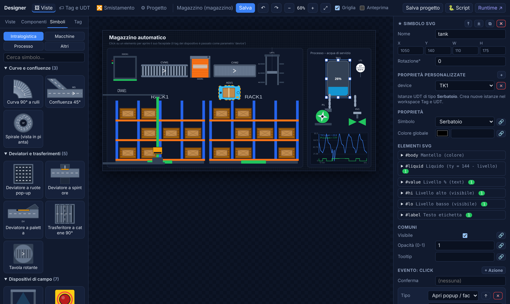
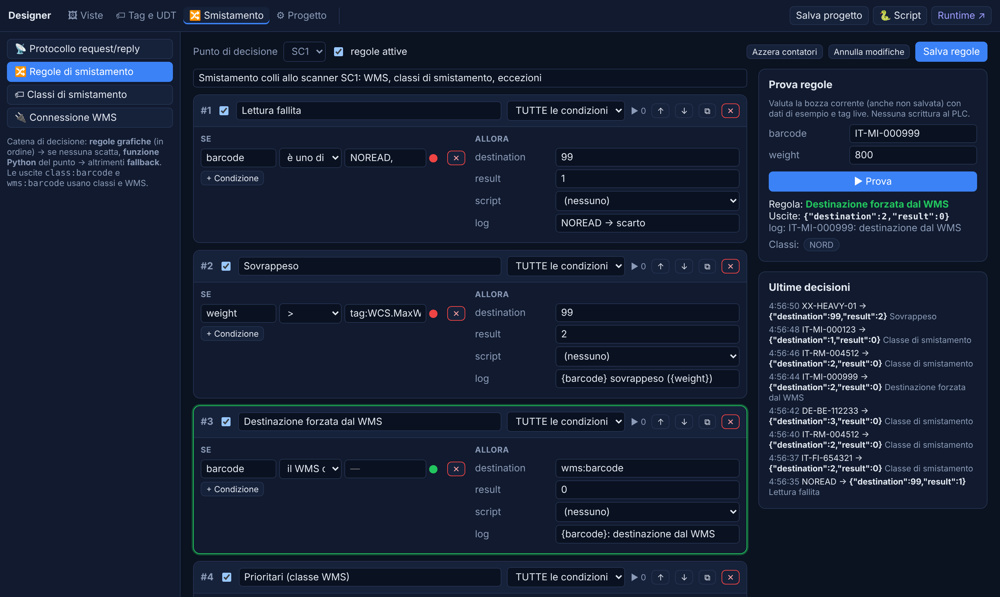
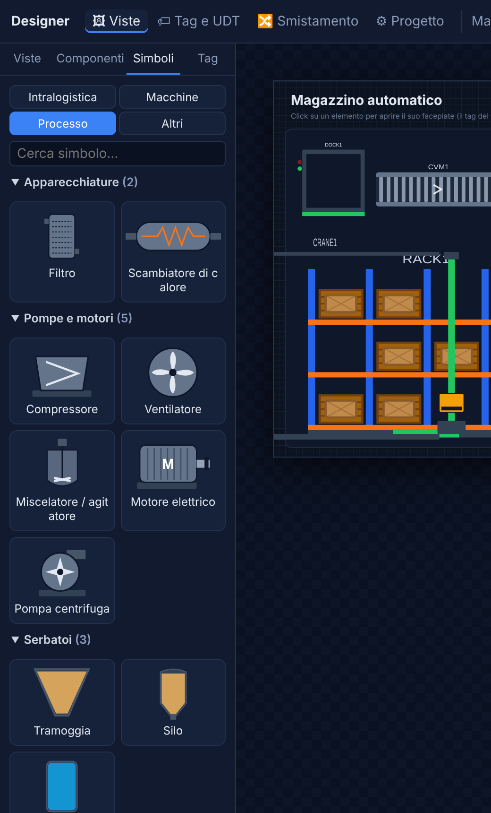
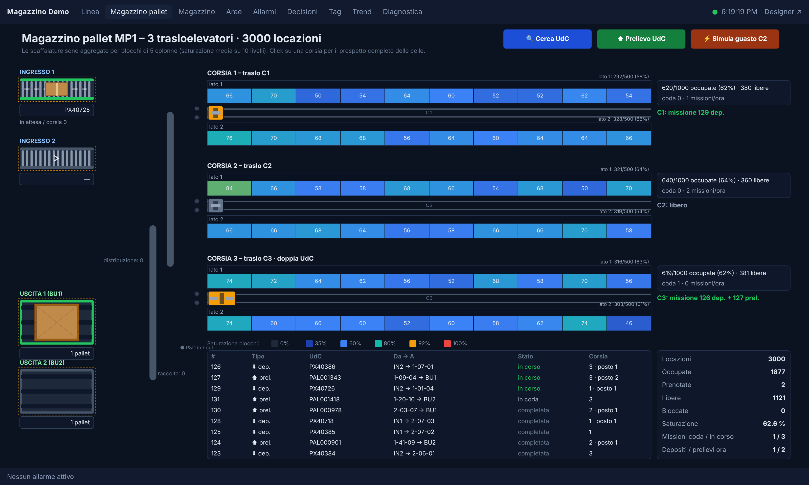
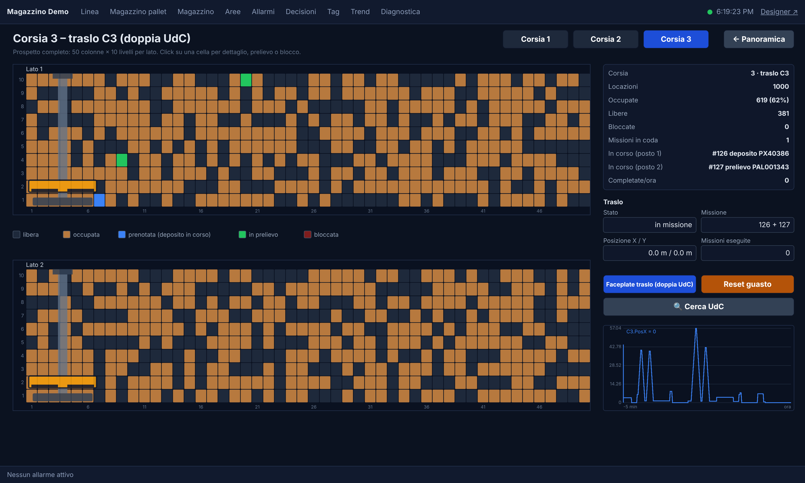

# PTWCS – WCS-SCADA

Warehouse Control System con funzioni SCADA. Il core è in **Rust**, le regole sono **grafiche (no-code)** o in **Python**, e l'HMI web ha un **Designer** in stile Ignition Perspective.

| | |
|---|---|
|  |  |
|  |  |

## Funzioni principali

- **PLC**: Siemens S7 (stack nativo, senza librerie C), Modbus TCP, OPC UA, EtherNet/IP (Logix) e un driver simulato.
- **Protocollo request/reply** definito nel Designer:
  - il telegramma è una UDT con ruoli (`request`, `response`, `input`, `output`);
  - handshake a **contatore** (ReqID/RespID) o a **flag** (Req/Ack).
- **Smistamento**:
  - regole grafiche ordinate, con test e traccia condizione per condizione;
  - **classi di smistamento** (pattern e barcode) locali o fornite dal **WMS**;
  - richiesta della destinazione al WMS via REST, con cache;
  - poi la funzione Python del punto e infine il fallback.
- **Tag**:
  - **UDT** con parametri e indirizzi a template (`DB{DB}.DBW{Base+2}`);
  - **scan class** per frequenza di lettura;
  - allarmi definiti sul tag;
  - modifiche dal Designer applicate **a caldo**, riavviando solo i driver coinvolti.
- **SCADA**:
  - viste multipagina e **aree** gerarchiche: allarmi, errori di qualità e perdita di comunicazione vanno nell'area del tag;
  - panoramica per area, trend, storico, log delle decisioni, audit.
- **Designer**, con quattro workspace:
  - **Viste**: componenti, libreria simboli a menu, import SVG, binding, eventi, parametri, viste incorporate, faceplate;
  - **Tag e UDT**: tag, tipi e istanze UDT, trend;
  - **Smistamento**: protocollo, regole, classi, WMS;
  - **Progetto**: aree, scan class, script a timer, driver.
- **Magazzino automatico** (AS/RS): locazioni persistenti, allocazione celle, missioni ai trasli, viste aggregate e di dettaglio (esempio con 3000 locazioni).
- **Libreria**: 74 simboli in 3 menu (Intralogistica, Macchine, Processo), 27 UDT standard per famiglia e **un faceplate per ogni simbolo**.

## Avvio rapido (demo)

Servono Rust ≥ 1.85 e Python ≥ 3.9 (il runtime non richiede pacchetti Python).

```bash
cargo build --release
```

PLC Modbus simulato (linea di smistamento):

```bash
./target/release/plc_sim 127.0.0.1:5020
```

WMS di prova (facoltativo, per la demo delle classi WMS):

```bash
python3 tools/mock_wms.py 8090
```

WCS:

```bash
./target/release/wcs_scada config/plant.yaml
```

Runtime su http://localhost:8080/ e Designer su http://localhost:8080/designer.html. La demo comprende:
- la **Linea**: scanner con smistamento su 3 uscite più scarto, regole grafiche, WMS e classi;
- il **Magazzino**: baia, porte, nastri, lift, traslo, scaffali, AGV e serbatoio, animati da uno script a timer; ogni elemento apre il suo faceplate.

## Esempio: magazzino automatico pallet (MP1)

Struttura: **2 ingressi, 2 uscite, 3 trasloelevatori (uno a doppia UdC), 3000 locazioni** (3 corsie × 2 lati × 50 colonne × 10 livelli).

| | |
|---|---|
|  |  |

**Il WCS (modulo `warehouse.rs`)**:
- gestisce locazioni e UdC su SQLite (persistenti al riavvio);
- sceglie corsia e cella: meno missioni in coda, poi più celle libere, poi cella più vicina al P&D; esclude le corsie con traslo in guasto o non in automatico;
- gestisce le missioni di deposito e prelievo, con prelievi bilanciati tra le baie d'uscita;
- dialoga con i trasli tramite un telegramma missioni (UDT `TrasloMissioni`):
  1. il WCS scrive tipo, origine e destinazione (colonna 0 = P&D), poi `Start` = 1;
  2. il PLC alza `Busy` e il WCS abbassa `Start`;
  3. a fine missione il PLC scrive `Done` = id missione e abbassa `Busy`.

**Traslo a doppia UdC**: si attiva per corsia con `slots: 2` (nell'esempio è la corsia 3, UDT `TrasloDoppiaUdC`).
- Il telegramma ha un secondo posto con i campi a suffisso `2`: `Mission2`, `Type2`, `Src…2`, `Dst…2`, `DstOut2`, `Done2`; inoltre `Loaded2` e `Fork2`.
- Il dispatcher invia fino a **due missioni per ciclo**, scegliendo come compagna una missione dello stesso tipo con la cella più vicina. Con una sola missione in coda attende fino a `pair_wait_s` secondi prima di partire con il solo posto 1.
- Il PLC scrive `Done` e `Done2` quando completa ciascuna missione, e i due posti si chiudono in modo indipendente.
- In libreria ci sono i simboli `asrs_lane2` (pianta) e `asrs_crane_mast2` (fronte), con relativi faceplate.

**Ingressi IN1/IN2**: telegramma request/reply (UDT `TelegrammaIngresso`) con regole grafiche:
- NOREAD, sovrappeso e fuori sagoma → respinto, con il codice esito;
- altrimenti l'uscita **`store:MP1`** alloca cella e missione e risponde con la corsia.

Pallet doppi e magazzino pieno finiscono nel default ("non stoccabile").

**Grafica** (le 3000 celle non sono tutte disegnate):
- **Panoramica** `mag_pallet`: ogni lato di corsia è aggregato in blocchi di 5 colonne, colorati per saturazione media sui 10 livelli. Mostra i trasli in movimento lungo la corsia, ingressi e uscite, i KPI per corsia e totali e le missioni.
- **Prospetto corsia** `mag_pallet_corsia`, aperto cliccando una corsia (navigazione con parametro `aisle`): mostra le 500 celle di ogni lato con il traslo sovrapposto. Il click su una cella apre dettaglio, prelievo e blocco. **Cerca UdC** apre la corsia giusta ed evidenzia la cella.
- Componenti riutilizzabili: `whmap` (modalità *pianta*, *blocchi*, *celle*), `whsummary` (KPI), `whmissions`.
- Azione evento *Magazzino*: cerca, preleva o deposita.

**API**: `/api/wh/{nome}/summary`, `side?aisle=&side=`, `missions`, `outbound`, `inbound`, `location`, `find?lu=`, `mission/{id}/cancel`.

Per ricreare l'esempio, a WCS avviato:

```bash
python3 tools/build_demo_pallet.py
```

La simulazione dei PLC (arrivi pallet, rulliere, trasli, baie) è lo script a timer `sim_pallet` in `scripts/rules.py`.

## Architettura

```
 Runtime HMI (index.html) ─┐            ┌─ Designer (designer.html)
                           │ REST + WebSocket
┌──────────────────────────┴────────────┴──────────────────────────────┐
│ web.rs       API, WebSocket live, viste, simboli, libreria, progetto  │
│ app.rs       stato, applicazione a caldo del progetto (driver,        │
│              punti di decisione, timer riavviati solo se cambiano)    │
│ config.rs    plant.yaml + project.yaml → config effettiva (UDT        │
│              espanse, telegrammi risolti, validazione completa)       │
│ decision.rs  handshake contatore/flag → regole → Python → fallback    │
│ rules.rs     motore regole grafiche (condizioni, rotazione, class:/wms:)│
│ sorting.rs   classi di smistamento, client WMS (cache, sync classi)   │
│ alarms.rs    allarmi per area, qualità, comunicazione (ISA-18.2)      │
│ script.rs    2 processi Python isolati: decisioni / HMI + timer       │
│ store.rs     SQLite: decisioni, allarmi, storico, audit               │
│ tagdb.rs     immagine live dei tag (qualità, timestamp)               │
│ drivers/     s7 · modbus · opcua · eip · sim  (scan class, blocchi)   │
└───────────────────────────────────┬──────────────────────────────────┘
                                    PLC                        WMS (REST)
```

Il **file di impianto** `config/plant.yaml` contiene server, scripting e driver, e si scrive a mano.

Il **progetto** `config/project.yaml` contiene aree, scan class, UDT, tag, punti di decisione, classi, WMS e timer, ed è gestito dal Designer. I salvataggi sono validati per intero: indirizzi, riferimenti, ruoli del telegramma. Prima di sovrascrivere il progetto viene fatto un backup.

Le regole grafiche stanno in `config/rules/<punto>.json` e le viste in `config/views/*.json`.

## Protocollo request/reply

Il telegramma si definisce come **tipo UDT** con un ruolo per membro. Per esempio, in un DB S7:

| Membro | Ruolo | Indirizzo (template) | Scritto da |
|---|---|---|---|
| ReqID | request | `DB{DB}.DBW{Base+0}` | PLC |
| Barcode | input | `DB{DB}.DBB{Base+2}` (STRING[20]) | PLC |
| Weight | input | `DB{DB}.DBD{Base+24}` | PLC |
| RespID | response | `DB{DB}.DBW{Base+28}` | WCS |
| Destination | output | `DB{DB}.DBW{Base+30}` | WCS |
| Result | output | `DB{DB}.DBW{Base+32}` | WCS |

Si crea un'istanza per ogni scanner (`SC1`, `SC2`… con il proprio DB/Base) e un punto di decisione con `telegram: SC1`. Gli alias delle regole sono i nomi dei membri in minuscolo (`barcode`, `weight`, `destination`…).

**Handshake a contatore**:
1. il PLC scrive i dati e poi incrementa ReqID;
2. il WCS decide, scrive le uscite e per ultimo RespID = ReqID;
3. il PLC usa le uscite solo quando RespID == ReqID; al timeout applica il proprio default.

**Handshake a flag**:
1. il PLC alza Req;
2. il WCS scrive le uscite e alza Ack;
3. il PLC abbassa Req;
4. il WCS abbassa Ack.

Tieni dati e request nella stessa area contigua, così vengono letti nello stesso blocco.

## Regole di smistamento

Sono un elenco ordinato: vince la **prima** regola abilitata le cui condizioni sono vere.

**Condizioni**:
- confronti `=`, `≠`, `>`, `≥`, `<`, `≤`;
- *compreso tra*, *inizia con*, *finisce con*, *contiene*, *è uno di*, *regex*, *vuoto*;
- *appartiene alla classe*, *ha una classe*, *il WMS conosce la destinazione*.

Si combinano con TUTTE oppure ALMENO UNA. I campi sono gli input del telegramma, `request_id` o `tag:Nome` (qualsiasi tag live).

**Uscite**:

| Valore | Effetto |
|---|---|
| `3` | valore fisso |
| `1\|2` | rotazione tra destinazioni equivalenti |
| `tag:Nome` | valore di un tag |
| `class:barcode` | destinazione della classe del collo |
| `wms:barcode` | destinazione chiesta al WMS |

Se un valore `class:` o `wms:` non si risolve, la regola viene saltata e si prova la successiva, così si costruiscono catene di fallback (es. WMS → classe → default). Una regola può anche delegare a una funzione Python.

**Ordine di decisione**: regole → **default** delle regole → **funzione Python** del punto → **fallback** del punto. Ogni decisione registra la regola che l'ha presa. Nel Designer si vedono i contatori per regola e si possono **provare** le bozze con dati di esempio prima di salvarle.

**WMS**. Endpoint configurabili:
- `GET {base}/parcels/{barcode}/destination` → `{"destination": "2", "class": "X"}` (un 404 significa collo sconosciuto);
- `GET {base}/sort-classes` → `[{"name", "destination", "barcodes", "patterns"}]` per le classi con origine WMS.

Le richieste hanno timeout breve e cache. Per i token negli header usa `${VARIABILE}`: il valore viene letto dall'ambiente del server. Un WMS di prova è in `tools/mock_wms.py`.

## UDT, tag, scan class, aree

- **Template di indirizzo**: `{Param}` inserisce il valore così com'è; `{Base+4}` o `{(Idx-1)*20}` sono espressioni intere; `{Instance}` è il nome dell'istanza. Esempi: `DB{DB}.DBX{Base+0}.3`, `hr:{Base+12}`, `ns=2;s={Instance}.Run`.
- **Allarmi** sul tag o sul membro UDT (op, soglia, gravità). Nei messaggi si può usare `{Instance}`.
- **Scan class**: periodo di lettura per tag, membro o istanza. Nello stesso ciclo i gruppi in scadenza sono letti insieme.
- **Aree** gerarchiche: un tag eredita l'area dall'istanza. In ogni area arrivano i suoi allarmi, un allarme aggregato `<area>.QUALITY` per i tag con qualità BAD e `COMM.<driver>` per la comunicazione (area del driver). Il runtime ha la pagina **Aree** con lo stato e il riconoscimento per area.

## Viste, parametri e faceplate (stile Perspective)

- **Parametri di vista** (`params`): una vista li riceve quando è aperta come popup o incorporata.
- **Proprietà personalizzate** del componente (`custom`, es. `device: LIFT1`).
- I binding usano **percorsi indiretti**: `{device}.Run`, `tag('{device}.Level') > 80`, `param('device')`.
- **Vista incorporata**: componente con parametri JSON passati dal padre al figlio (`{"device": "{device}"}`).
- **Azione popup**: apre una vista come finestra flottante con parametri. È così che un simbolo passa il proprio tag al faceplate.
- **Simboli di libreria**: al drop il componente riceve la proprietà `device`, i binding predefiniti della famiglia e il click che apre il faceplate. Basta scegliere l'istanza UDT dal menu.
- **Elementi SVG animabili** (per `id`): `fill`, `stroke`, `visible`, `opacity`, `text`, `rotate` (con perno `data-pivot`), `tx`/`ty` (traslazione), `flow` (flusso), `blink`, `spin`.
- **Componenti**: nastro, motore, lampada, valore, testo, pulsante, serbatoio, barra, forme, linea/tubo animato, simbolo SVG, vista incorporata, **trend** (storico più live).

**Scala della libreria**: 30 unità corrispondono alla larghezza di un nastro.
- I trasporti (nastri, rulliere, accumulo, catenarie, sorter, corsie traslo, tubazioni) sono a **lunghezza variabile**: allungandoli aumenta il numero di rulli, non la loro dimensione; aumentandone la larghezza crescono rulli e dettagli. I binding possono usare `param('_len')`, la lunghezza corrente del simbolo.
- Tutti gli altri simboli hanno una **dimensione nativa** coerente con questa scala (usata al drop) e si ridimensionano senza deformarsi.

La libreria si rigenera con `python3 tools/gen_library.py config`. Il generatore produce simboli, UDT, binding predefiniti e faceplate partendo dalle stesse definizioni.

## Script Python (`scripts/rules.py`)

```python
def decide_sc1(req, ctx):              # punto di decisione (se nessuna regola scatta)
    return {"destination": 2, "result": 0}

def start_line(payload, ctx):          # evento HMI (pulsante)
    ctx.write("CV1.Run", True)
    return {"message": "Linea avviata"}   # oppure {"popup": "fp_x", "params": {...}}

def sim_magazzino(payload, ctx):       # script a timer (Progetto → Script a timer)
    ctx.write("LIFT1.PosPct", 50)
```

`ctx.tag(n)`, `ctx.tags`, `ctx.write(tag, v)`, `ctx.log(msg)`. Ci sono due processi Python separati: uno per le decisioni (tempo reale) e uno per HMI e timer. Uno script bloccato viene terminato e riavviato. Gli script a timer possono scrivere anche i tag di stato dei soli driver `sim`.

## Protocolli e indirizzi

| Protocollo | Indirizzi | Note |
|---|---|---|
| S7 | `DB10.DBX0.1` `DB10.DBW2` `DB10.DBD4` `DB10.DBB8` `M10.0` `MW20` `I0.0` `Q0.1` | S7-1200/1500: abilitare PUT/GET e disattivare l'accesso ottimizzato. STRING S7 |
| Modbus | `coil:N` `di:N` `hr:N` `ir:N` `hr:N.bit` | offset 0-based, 32 bit = 2 registri big-endian |
| OPC UA | `ns=3;s="DB"."ReqID"` | `--features opcua`, SecurityPolicy None |
| EtherNet/IP | nome tag Logix | `--features eip`, STRING in sola lettura |

Per compilare con tutti i protocolli:

```bash
cargo build --release --features opcua,eip
```

## Test

```bash
cargo test
```

Comprende anche un test end-to-end del decision engine (UDT telegramma, handshake a flag, regole e classi) e la validazione della config demo.

I driver si provano contro server di protocollo reali. Installa i server:

```bash
pip install python-snap7 asyncua cpppo
```

**S7** — avvia il server:

```bash
python tools/s7_test_server.py 1102
```

poi lancia il test:

```bash
S7_TEST_PORT=1102 cargo test --test s7_integration
```

**OPC UA** — server:

```bash
python tools/opcua_test_server.py 4841
```

test:

```bash
OPCUA_TEST_PORT=4841 cargo test --features opcua --test opcua_integration
```

**EtherNet/IP** — server:

```bash
python -m cpppo.server.enip --address 127.0.0.1:44818 ReqID=DINT Run=BOOL Temp=REAL Cnt=INT
```

test:

```bash
EIP_TEST_HOST=127.0.0.1 cargo test --features eip --test eip_integration
```

## Limiti noti e prossimi passi

- **Autenticazione e ruoli assenti**: chiunque raggiunga la porta può scrivere tag e modificare il progetto. In produzione imposta `server.designer: false` e metti il servizio su una rete isolata o dietro un reverse proxy con login. Il prossimo passo è aggiungere utenti e ruoli.
- **Viste incorporate**: i parametri vanno solo dal padre al figlio; i parametri di output (dal figlio al padre) non ci sono ancora.
- **OPC UA**: manca la cifratura e la lettura avviene a polling, senza subscription.
- **EtherNet/IP**: una richiesta per tag.
- **Driver** e **ridondanza**: i driver si configurano ancora solo in `plant.yaml`; non c'è un'istanza attivo/standby.
